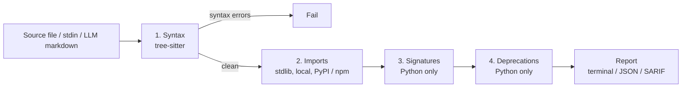

# AI Hallucination Firewall

A verification layer that checks AI-generated code against real sources (PyPI, npm, real function signatures) before it reaches your codebase.

[](./LICENSE)
[](https://github.com/tranhoangtu-it/ai-hallucination-firewall)


## The Problem

AI coding assistants regularly emit code that looks right but is not: they import packages that do not exist, call functions with the wrong signature, or reach for APIs that were deprecated long ago. These mistakes read fluently, so they slip through review and surface later as runtime errors. This project runs a layered check on the code, using syntax parsing, registry lookups and signature inspection, so those mistakes are caught at commit time or in CI.

## How it works

`ValidationPipeline` (`pipeline/runner.py`) runs four layers in order. A syntax error stops the run, because the AST is unreliable after that.



## Quick start

Requires Python 3.11+. Install from source:

```bash
pip install git+https://github.com/tranhoangtu-it/ai-hallucination-firewall
```

CLI (the entry point is `firewall`):

```bash
firewall check path/to/file.py              # check one or more files
firewall check --stdin --language python    # read code from stdin
firewall check src/app.py --format sarif    # terminal (default), json or sarif
firewall check src/app.py --ci              # strict CI mode
firewall parse response.md                  # validate code blocks in LLM markdown output
firewall init                               # write a .firewall.toml in the current directory
firewall serve                              # start the validation API (default 127.0.0.1:8000)
```

`firewall check` exits with status 1 if any file fails. `firewall check` takes file paths (not directories); `firewall parse` also accepts `--stdin` or `--url`.

Pre-commit (hook ids are defined in `.pre-commit-hooks.yaml`):

```yaml
# .pre-commit-config.yaml
repos:
  - repo: https://github.com/tranhoangtu-it/AI-Hallucination-Firewall
    rev: v0.1.0   # use the latest tag
    hooks:
      - id: firewall-check       # Python files
      - id: firewall-check-js    # JavaScript / TypeScript files
```

```bash
pip install pre-commit && pre-commit install
```

Optional configuration lives in `.firewall.toml` (created by `firewall init`):

```toml
[firewall]
languages = ["python", "javascript"]
severity_threshold = "warning"
cache_ttl_seconds = 3600
output_format = "terminal"

[firewall.registries]
pypi_enabled = true
npm_enabled = true
timeout_seconds = 10
```

## What it detects

Each row maps to an `IssueType` emitted by a pipeline layer.

| Check | Issue type | Languages | Example |
|-------|-----------|-----------|---------|
| Syntax errors (tree-sitter ERROR / MISSING nodes) | `syntax_error` | Python, JS, TS | `def f(:` |
| Imports of packages that exist nowhere (not stdlib, not installed, not on PyPI/npm) | `nonexistent_package` | Python, JS, TS | `import fast_quantum_ml` |
| Too many arguments | `wrong_signature` | Python | `f(1, 2, 3)` where `f` takes two parameters |
| Missing required arguments | `missing_required_arg` | Python | `f()` where `f(x)` needs `x` |
| Unknown keyword arguments | `unknown_parameter` | Python | `json.dumps(data, compress=True)` |
| Deprecated stdlib APIs, with a suggested replacement (static rule table) | `deprecated_api` | Python | `os.system(...)` suggests `subprocess.run()` |

Notes on severity: missing packages and syntax errors are reported as errors; signature and deprecation findings are reported as warnings. Signature checks are skipped when a call uses `*args` or `**kwargs`.

## Example output

The terminal reporter prints a panel per file with a table of issues, then a summary when several files are checked. For a file that imports a package that does not exist, the report looks roughly like this (layout simplified):

```
╭───────────────────────────────────────────╮
│ demo.py (python) — FAILED                 │
╰──────────────── 1 errors, 0 warnings ─────╯
 ✗  L0:0   nonexistent_package   Package 'fast_quantum_ml' not found on PyPI or locally
                                   → Check spelling. Similar packages may exist.
```

## Supported languages

- Python: all four layers
- JavaScript (`.js`, `.jsx`, `.mjs`) and TypeScript (`.ts`, `.tsx`): syntax and npm import checks. TypeScript is parsed with the JavaScript grammar, so the syntax check is basic.

## VS Code extension

The [`vscode-extension/`](./vscode-extension/) folder contains an extension that validates Python, JavaScript and TypeScript files by calling the API server (`firewall serve`). Settings: `hallucinationFirewall.apiEndpoint` (default `http://localhost:8000`), `hallucinationFirewall.triggerMode` (`onSave` or `onChange`), `hallucinationFirewall.debounceDelay` and `hallucinationFirewall.enabled`.

## Project site

https://tuth.site/AI-Hallucination-Firewall/

## License

MIT. See [LICENSE](./LICENSE).
